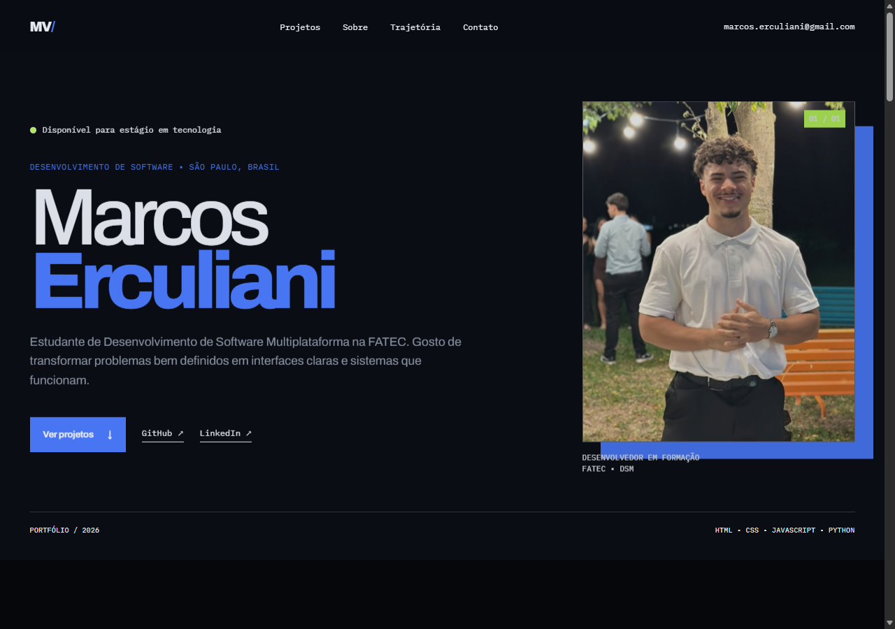

# Portfólio · Marcos Erculiani

Portfólio acadêmico e profissional com os projetos desenvolvidos na FATEC São José dos Campos (DSM), ferramentas criadas para a operação logística na Intercarta e trabalhos anteriores.

Demo online: https://marcoserculianipw.github.io/meuportifolio/



## Estrutura da página

- **Apresentação:** resumo da minha formação (Técnico em Desenvolvimento de Sistemas pela ETEC e 1º semestre de DSM na FATEC SJC), rotina atual na Intercarta e objetivo de estágio.
- **Projetos API (FATEC DSM):** *Negado pelo Banco* (análise de crédito inclusivo com dados públicos do Banco Central em Python/Flask e MariaDB, onde atuei como Scrum Master e desenvolvedor na equipe Time00.dev).
- **Projetos Profissionais e Pessoais:**
  - *Recebimento de Materiais (PWA):* web app em React e TypeScript para conferência de cargas e fotos de DANFE pelo celular.
  - *Painel de Automação Desktop:* utilitário nativo para Windows em PowerShell e WPF/XAML para abertura de sistemas e planilhas do turno.
  - *Site · Lucas Pelizer (Nutricionista):* página responsiva para captação de pacientes no WhatsApp.
  - *FNCASH:* sistema web de controle financeiro em Python e MySQL (TCC da ETEC).
- **Informações Curriculares:** formação acadêmica, vínculo profissional, certificações (IBS Americas, FGV, Santander/Google) e participação em eventos (WorCAP INPE 2026 e Innovation Week SJC 2026).
- **Contato:** links diretos para e-mail, LinkedIn e GitHub.

## Tecnologias utilizadas no portfólio

- HTML5 semântico
- CSS3 (Grid, Flexbox e variáveis CSS)
- JavaScript puro (Vanilla JS)

## Como rodar localmente

1. Clone o repositório:
```bash
git clone https://github.com/marcoserculianipw/meuportifolio.git
```
2. Abra o arquivo `index.html` diretamente no navegador.
