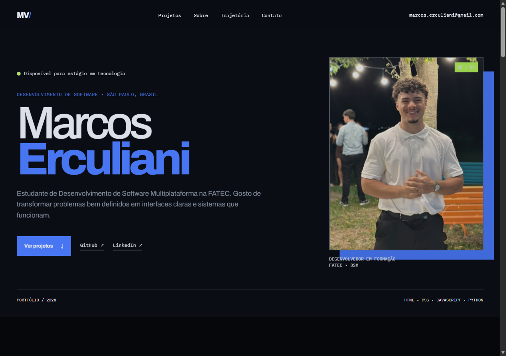

# Portfólio — Marcos Erculiani

Site pessoal para apresentação de projetos, formação acadêmica e trajetória em desenvolvimento de software.

Demo online: https://marcoserculianipw.github.io/marcos-portifolio/



## Sobre o projeto

Desenvolvi meu portfólio com foco em clareza e carregamento rápido para apresentar meu perfil profissional a recrutadores técnicos. A página reúne minha formação acadêmica (Técnico pela ETEC e estudante de DSM na FATEC), projetos práticos desenvolvidos e canais diretos de contato. As imagens de apoio foram embutidas em Base64 no próprio script para assegurar que a interface funcione sem dependência de caminhos externos.

## Seções da página

- **Apresentação:** síntese do meu perfil profissional e objetivo de estágio em desenvolvimento
- **Projetos:** apresentação do Recebimento de Materiais (aplicação PWA em React e TypeScript para logística), Painel de Automação Desktop (ferramenta operacional em PowerShell e WPF), Landing Page do Lucas Pelizer (nutricionista esportivo real) e FNCASH (sistema de gestão financeira - TCC ETEC)
- **Sobre Mim:** histórico de formação e experiência prática de rotina como Jovem Aprendiz em logística
- **Contato:** atalhos diretos para e-mail, perfil no LinkedIn e repositórios no GitHub

## Tecnologias

- HTML5 semântico
- CSS3 (Flexbox, Grid, variáveis de estilo e tipografia)
- JavaScript puro (Vanilla JS)

## Como rodar localmente

Não há etapas de build ou instalação de dependências:

1. Clone o repositório:
```bash
git clone https://github.com/marcoserculianipw/marcos-portifolio.git
```
2. Abra o arquivo `index.html` diretamente em seu navegador.
